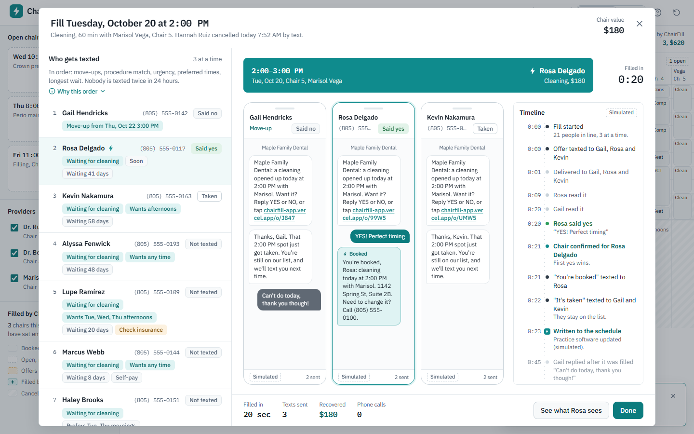
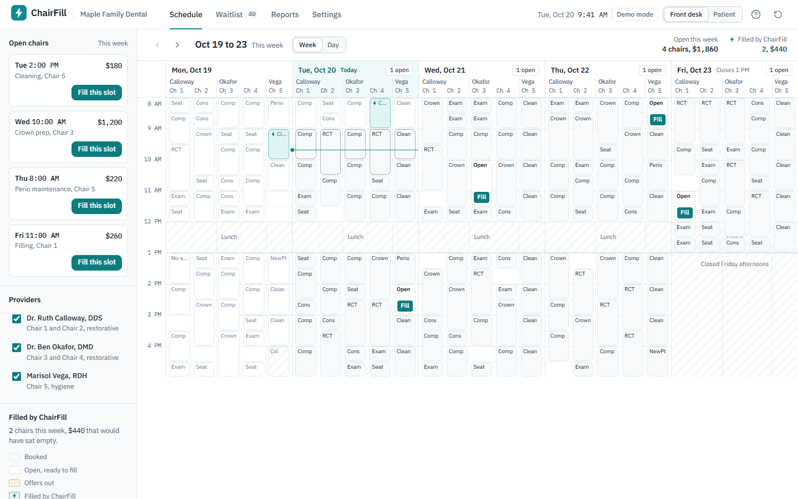
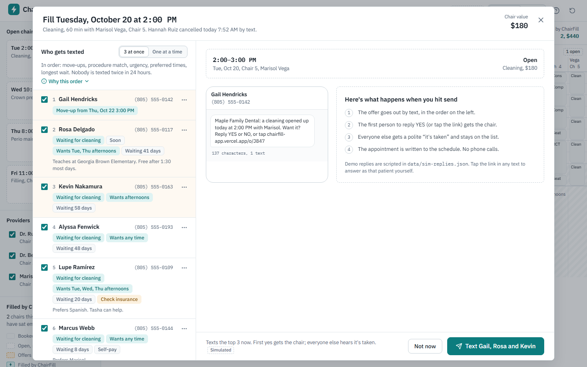
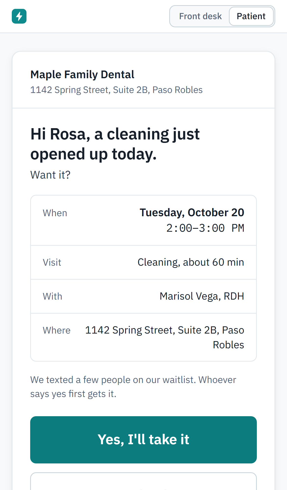
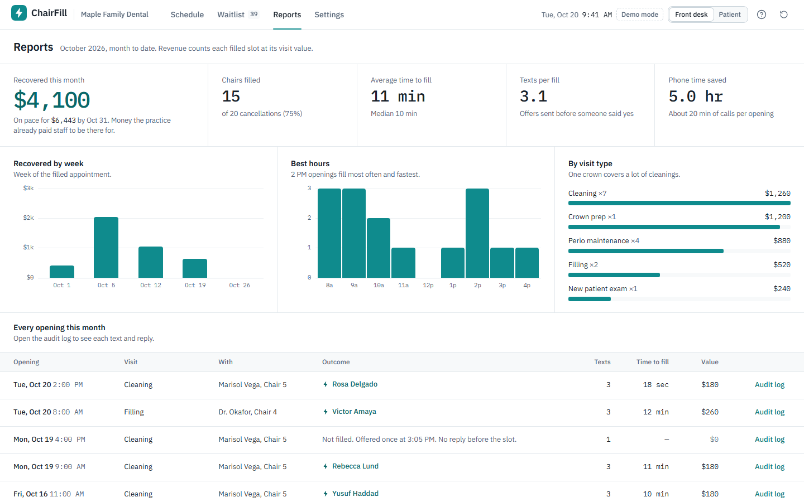

# ChairFill

**A cancelled appointment becomes a filled one without a phone call.** ChairFill keeps a ranked waitlist for a dental practice. When a slot opens, it texts the right patients in order; the first yes gets the chair, everyone else is told politely, and the schedule updates.

**Live demo:** https://chairfill-app.vercel.app · **Explainer (25 s):** [public/explainer.mp4](public/explainer.mp4) · **Click-by-click script:** [DEMO.md](DEMO.md)

This is a portfolio demo for a fictional client, **Maple Family Dental** in Paso Robles, CA: two dentists, a hygienist, five chairs, and a front desk of two who are on the phone all day. Everything runs in demo mode on seeded data. No real texts are sent and nothing leaves the browser.



## Run it

```bash
npm run demo
```

That installs dependencies and starts the app at http://localhost:3000. Node 20 or newer. No accounts, keys or environment variables needed.

Other commands: `npm test` (52 unit tests), `npm run test:e2e` (Playwright runs the demo script against a production build), `npm run build`, `npm run data` (regenerates `/data` from `scripts/generate-data.mjs`).

## The 90-second demo

1. **Schedule.** Tuesday, 9:41 AM. Hannah cancelled her 2:00 PM cleaning by text. The slot is a dashed outline, and the left rail lists four open chairs worth $1,860 this week.
2. **Fill this slot.** ChairFill has ranked everyone who could take it, with each person's reasons as chips: Gail (booked Thursday, a move-up), Rosa (wants Tuesday afternoons), Kevin (waiting 58 days).
3. **Text Gail, Rosa and Kevin.** Offers fly out to three phones. Delivered, read, typing… Rosa says **YES** at 0:20. The slot turns teal with one soft pulse; Gail and Kevin get "it's taken, you're still on our list."
4. **See what Rosa sees.** The patient page: the appointment, two big YES/NO buttons (already answered), then a confirmation with directions, prep instructions and add-to-calendar.
5. **Done.** The schedule shows the bolt on Tuesday 2:00 PM. Three open chairs left.
6. **Reports.** October: $4,100 recovered, 15 chairs filled, about 11 minutes to fill, best hours, every opening with its audit log.
7. **Settings.** The ranking rules, offer strategy, message templates with merge fields, quiet hours.
8. **The ? button** plays the 25-second explainer.

The full script with what to say, plus the extras (the $1,200 crown move-up that opens a second slot, answering as a patient yourself, one-at-a-time mode), is in [DEMO.md](DEMO.md).

| Schedule | Ranked and explained | Patient page (phone) | Reports |
|---|---|---|---|
|  |  |  |  |

## What's in it

| Screen | Route | What it does |
|---|---|---|
| Schedule | `/schedule` | Week view by provider and chair (practice-software style time grid), day view with full names, phone agenda. Cancelled slots are dashed with a Fill button; ChairFill fills carry a bolt; offers-out slots go amber. Left rail: open chairs with dollar values, provider filters, legend. |
| Fill sequence | `/schedule?fill=<id>` | Ranked candidates with reason chips and the rule order on screen; 3 at once or one at a time; manual override (text one person, or book someone who said yes on the phone); live simulated phones; timeline with timecode stamps; first-yes-wins; polite declines; late replies logged, never double-booked; minutes-to-fill summary. |
| Waitlist | `/waitlist` | 40 patients: visit, urgency, preferred days and times, days waiting, last offer and how it went, insurance eligibility flags. Add/edit drawer, CSV import with row-by-row validation, practice-software sync (stub). |
| Patient page | `/o/<code>` | What the link in the text opens: one centered card, two giant buttons, then the confirmation with directions and prep. Taken, declined, timed-out and not-found states. QR code to open it on a phone. |
| Reports | `/reports` | Recovered this month and on-pace projection, chairs filled vs cancellations, average and median time to fill, texts per fill, phone time saved, by week, best hours, by visit type, and every opening with an audit log. |
| Settings | `/settings` | Rule order and toggles, rest period and daily cap, offer strategy, message templates (merge-field buttons, live preview, SMS segment count), quiet hours, visit values, practice and providers, connections, team, demo controls. |
| Setup wizard | `/setup` | Practice and providers, visits and values, waitlist import, offer strategy, templates, quiet hours, then a test fill on a sample slot that texts three staff test phones and never touches the real schedule. |
| Role switcher | header | **Front desk / Patient** stands in for login. |

### How the ranking works

Shown in the fill screen and editable in Settings:

0. **Move-ups first.** Patients already booked later for the same visit with the same provider, who said earlier is fine.
1. **Procedure match.** A cleaning slot goes to people waiting for a cleaning. Other visits that fit the length and provider come after (toggle).
2. **Urgency.** Urgent, then soon, then routine.
3. **Preferred times.** Day and time-of-day both match, then one of them, then neither.
4. **Longest wait.**

Nobody is texted twice within the rest period (24 hours) or more than the daily cap (2). Landline-only patients and duplicate mobiles are listed as "not texted" with the reason, never silently dropped. Texts never go out during quiet hours (8 PM to 8 AM).

## How it's built

- **Next.js 15 (App Router), TypeScript, Tailwind CSS 4, Framer Motion, Zustand, lucide icons.** IBM Plex Sans and Plex Mono through `next/font`.
- **`lib/sms-sim.ts`** is the simulated SMS conversation engine: a pure, event-driven state machine in "sim time." Offers, deliveries, reads, typing, replies, expiries, confirmations and "taken" notices are all events. Replies are scripted per patient in `data/sim-replies.json`.
- **`components/sim-driver.tsx`** plays runs in real time at the demo pace and fast-forwards quiet stretches (a 10-minute offer window takes about 2 seconds on screen, while the timeline still shows true sim time). Only one tab drives the simulation (Web Locks); other tabs follow through localStorage, and the patient page posts replies to a small inbox, so a YES tapped in another tab lands in the running fill.
- **`lib/ranking.ts`** is the priority logic. **`lib/reports.ts`** is the dollars. Both are unit-tested.
- **`lib/store.ts`** holds the demo state in memory and localStorage, seeded from `/data/*.json`. "Reset demo data" restores the seed.
- **`lib/adapters/*`** puts every outside service behind an adapter with a mock and a one-line TODO naming the real service: `sms.ts` (Twilio), `pms.ts` (Open Dental / Dentrix), `maps.ts` (Google Maps), `calendar.ts` (.ics, works for real).
- **`/video`** is the Remotion project for the explainer, rendered to `public/explainer.mp4`. See [video/README.md](video/README.md).
- **Auth seams** are marked with `AUTH:` comments (`lib/store.ts`, `app/(desk)/layout.tsx`, `app/setup/page.tsx`).

```
app/            routes (desk pages under (desk)/, patient page at o/[code], setup, OG image, icons, 404)
components/     schedule/, fill/, waitlist/, reports/, settings/, setup/, patient/, shell, ui, brand
lib/            ranking, sms-sim, store, seed, reports, templates, csv, time, adapters/
data/           practice, providers, schedule, waitlist, templates, sim-replies, history (generated)
scripts/        generate-data.mjs, screenshot helpers
tests/          unit/ (vitest), e2e/ (Playwright)
video/          Remotion explainer
```

## Decisions I made

The brief left these open. I picked whatever made the demo feel most finished.

- **The client.** Maple Family Dental, 1142 Spring Street, Suite 2B, Paso Robles, CA. Dr. Ruth Calloway, DDS (Chairs 1 and 2), Dr. Ben Okafor, DMD (Chairs 3 and 4), Marisol Vega, RDH (Chair 5, hygiene). Front desk: Kim Albers and Tasha Reyes. Office manager: Denise Farrow. Hours Mon to Thu 8 to 5 with lunch at noon, Friday 8 to 1.
- **A fixed demo clock.** The demo always opens on **Tuesday, October 20, 2026 at 9:41 AM Pacific** and runs forward in real time. The data is one real month: October 2026 history plus two weeks of schedule (Oct 19 to 30). A clock tied to "today" would drift the seeded cancellations into the past.
- **Visit values.** Cleaning $180, perio maintenance $220, new patient exam $240, filling $260, crown prep $1,200, root canal $980, limited exam $95 (crown seats and implant consults are on the schedule but not waitlist visits). The seeded month is exactly **14 chairs and $3,920**, the numbers in the explainer.
- **Defaults.** Three at once (first yes wins), a 10-minute answer window for one-at-a-time, 24-hour rest between offers, 2 offers a day max, quiet hours 8 PM to 8 AM, a warning for slots under 60 minutes away.
- **Additions beyond the brief.** "Other visits that fit" as a lower ranking tier. Move-up chains: when a move-up wins, their old slot opens and the desk is offered the next fill. A fourth template ("thanks for letting us know") for patients who say no. Late YES replies are logged and never double-book. Duplicate mobiles get one text. A "phone time saved" stat (20 minutes of calls per opening). An on-pace projection.
- **Demo pacing.** Replies play at 2× by default (Settings, Demo, Reply speed). Gaps longer than 12 sim-seconds fast-forward with an on-screen "skipping quiet" note. Scripted replies follow the brief (yes after 20 s, no after 45 s, no reply).
- **Accessibility over exact brand hexes, for text only.** White text on brand teal `#0F8B8D` is 4.1:1 and slate `#6B7A8C` on white is 4.4:1, both just under WCAG AA for small text. Buttons and links use `#0C7C7E` (5.0:1), text on soft teal uses `#0A6869`, and secondary text uses `#566577`. The brand values still drive fills, borders, icons and large type. I added one red (`#B42318`) for errors and no-shows, which the brief's palette doesn't cover.
- **Light only.** It sits next to practice software, which is light.
- **Week view.** A day-by-chair time grid like Dentrix or Eaglesoft. Week lanes are about 40px wide, so booked blocks show a short visit code (Clean, Perio, Comp, Crown, RCT, Exam) and the day view shows full names. Open slots, offers-out and ChairFill fills are what stand out.
- **The patient page is white-label.** It shows Maple Family Dental, with a small "Sent with ChairFill" footer.
- **Explainer placement.** The ? in the header, step 1 of setup, the empty waitlist, and Settings, Demo. It's a rendered MP4 rather than an embedded Remotion player: smaller, and it doesn't ship Remotion to patients.
- **Messy data on purpose.** Two Brandt records sharing one mobile, a landline-only patient, "Jonh Pruitt" (a typo the desk noted), "MARGARET O'NEIL" in all caps, a recall overdue 7 months, expired and needs-check insurance, a no-show, a same-day cancellation nobody took, and a transposed name in the schedule.
- **Stack.** Next.js 15.5 as briefed (16 is out; 15 was the instruction). `framer-motion` as briefed. Zustand for state. Hosted at **chairfill-app.vercel.app** (chairfill.vercel.app was taken), deployed from `main`.

## Stubbed

The UI is there and the action is simulated, so the demo never dead-ends:

- **Real text messages.** The Twilio adapter is mocked. Every message is tagged "Simulated."
- **Practice software sync.** The schedule is seeded; the waitlist imports from CSV. The "Practice software" import tab and the Connect buttons explain the production version.
- **Phone-to-desk live replies across devices.** A YES in another tab of the same browser reaches the running fill. A phone that scans the QR code keeps its own demo copy, because cross-device needs a backend (Twilio inbound webhook to a database).
- **Maps.** "Open in Maps" shows a simulated note instead of linking a real address.
- **Sign-in and team invites.** The role switcher stands in for login. Invite and Connect are disabled, with the reason on hover.
- **Queueing offers for the end of quiet hours.** During quiet hours the fill screen says offers wait until 8:00 AM and disables sending, rather than scheduling the send. The demo clock never reaches quiet hours. The audit log for the Sunday-night history fill shows how it would read.
- **Reports beyond October 2026.** One month of history.

## Done checklist

- [x] Vercel link: https://chairfill-app.vercel.app (auto-deploys from `main`)
- [x] A cancelled slot fills live through the simulation in under 60 seconds (about 10 seconds real time; 0:20 on the timeline)
- [x] Priority rules visible: rule order on the fill screen, per-patient reason chips, editable in Settings
- [x] Patient YES page works on a phone (Playwright runs it at iPhone 13 size)
- [x] Wizard completes, ending in a test fill
- [x] Reports populated (14 chairs and $3,920 seeded, updated live)
- [x] Explainer embedded (header ?, setup step 1, empty waitlist, Settings)
- [x] README demo script (above, plus [DEMO.md](DEMO.md))
- [x] OG image (`app/opengraph-image.tsx`), favicon, apple icon, page titles, loading skeletons, in-character 404

## Tests

- `npm test`: unit tests for ranking order on every seeded cancellation, cooldown, daily cap, duplicates, the SMS engine timing (batch, one-at-a-time, timeouts, live replies, late replies), quiet hours, SMS segment math, CSV import, report math and the calendar file.
- `npm run test:e2e`: Playwright builds the app and runs the demo script end to end (schedule, fill, reports, explainer, patient YES at phone size, setup wizard), the move-up chain, the OG image and the 404. Set `E2E_BASE_URL=https://chairfill-app.vercel.app` to run it against the live site.

## Restyle: the control room (Oct 20, 2026)

The first build was "calm clinical" and read as a calendar app. This pass keeps every line of logic and changes the skin so the first five seconds sell the product:

- **A dark stage with one signal color.** Design tokens keep their names (`white`, `ink`, `surface`, `line`, `teal`…) so every component kept working; their values now map onto a dark stage. Signal teal `#19D3C5` always means "ChairFill did this"; amber means offers in flight.
- **A front door at `/`.** One serif sentence, the 25-second fill on a loop, one button. "Watch a chair fill" opens the first open chair straight into the fill screen (`/schedule?fill=first`).
- **The fill is the show.** The winning phone lifts and glows, the others dim, the booked slot pulses, and a serif line lands under it: "Rosa Delgado, 2:00 PM. Nobody picked up a phone."
- **Open chairs breathe.** Every dashed outline pulses signal teal on a three-second cycle (static under reduced motion).
- **Reports open on the number.** Recovered-this-month at 88px, with the sentence it deserves.
- **Phones open on the moment.** On narrow screens the day view starts with today's open chairs as thumb-sized cards, before the per-chair lists.
- **Type.** Instrument Serif (italic) for the few human sentences; IBM Plex Sans and Mono for everything the desk reads. A 3.5% film grain sits over the stage as a CSS layer.

Decisions made without asking: light mode was dropped rather than maintained as a second theme; the explainer loop on the landing page reuses the existing Remotion render; the patient page stays light on purpose (it is what the patient sees, not what the desk sees).
